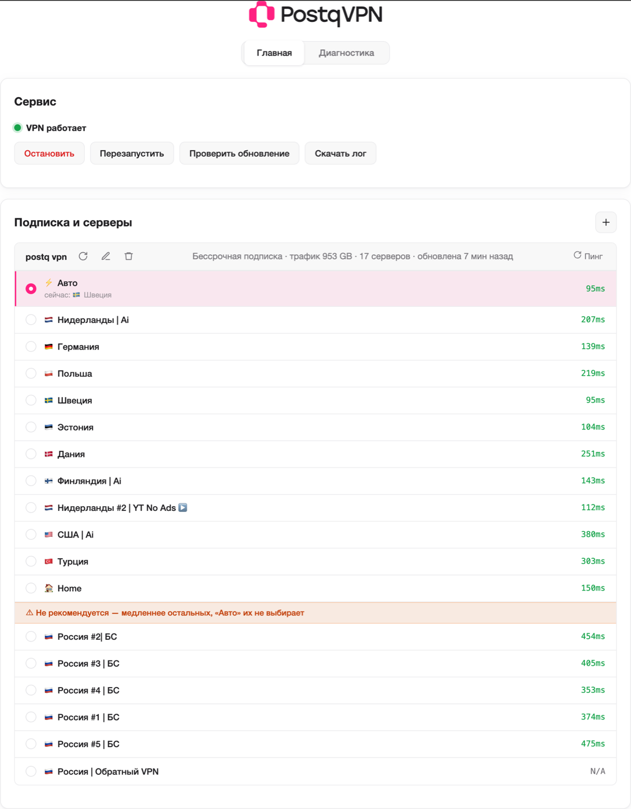

<div align="center">

<h1>
  <picture>
    <source media="(prefers-color-scheme: dark)" srcset="docs/logo-dark.svg">
    
  </picture>
</h1>

<p>
  VPN-подписка <a href="https://postq.space">postq vpn</a> прямо на роутере с <b>OpenWrt</b>
</p>

<a href="https://github.com/postq-vpn/postq-OW/releases/latest"></a>

<br><br>



</div>

<br>

PostQ VPN ставится на роутер одной командой и работает прямо на нём. VPN получают все устройства домашней сети —
телефоны, компьютеры, телевизоры, приставки — без отдельных приложений на каждом.

Настраивать ничего не нужно: вставьте ссылку на подписку, и роутер сам выберет быстрый сервер, а заблокированные
сайты и сервисы пустит через VPN. Российские сайты, банки и игры продолжат работать напрямую, без замедления.

&nbsp;

## 📋 Что понадобится

- Роутер с **OpenWrt 24.10** или новее (подходят прошивки и на `opkg`, и на `apk` — OpenWrt 25.12)
- Около **50 МБ** свободного места во встроенной памяти. Роутеры с флеш-памятью 16 МБ не подходят
- Ссылка на подписку postq vpn — вида `https://vpn.postq.space/…`
- Компьютер в той же сети на время установки

&nbsp;

## ⚡️ Установка

1. Подключитесь к роутеру по SSH. В терминале компьютера (PowerShell в Windows, «Терминал» в macOS и Linux):

   ```sh
   ssh root@192.168.1.1
   ```

2. Выполните одну команду:

   ```sh
   sh <(wget -O - https://raw.githubusercontent.com/postq-vpn/postq-OW/main/install.sh)
   ```

   Установщик ничего не спрашивает: ставит PostQ VPN, русский интерфейс и ядро sing-box с поддержкой XHTTP,
   а в конце показывает адрес страницы.

3. Откройте в браузере веб-интерфейс роутера → **Службы** → **PostQvpn**
   (или сразу `http://192.168.1.1/cgi-bin/luci/admin/services/postq`).

4. Вставьте ссылку на подписку и нажмите **«Подключить»**. Через несколько секунд VPN заработает,
   а ниже появятся серверы.

&nbsp;

## ✨ Возможности

### Подписка и серверы

- **Одна страница вместо десятка настроек:** статус VPN, кнопки запуска и перезапуска, подписка и список
  серверов с флагами и пингом — в светлой и тёмной теме, как в PostqVPN для Keenetic
- **Подписка одной строкой:** название, срок, трафик, число серверов и когда она обновлялась; рядом кнопки
  обновить, изменить и удалить. Ссылка видна только при изменении, «+» добавляет ещё одну подписку
- **⚡ Авто** — самый быстрый зарубежный сервер выбирается сам; под «Авто» видно, какой сервер работает сейчас
- **Выбор сервера в один клик.** Если выбранный вручную сервер перестал отвечать, через полторы минуты роутер сам
  вернётся на «⚡ Авто» и покажет об этом сообщение
- **Российские серверы — в конце списка** под плашкой «Не рекомендуется»: «Авто» их не выбирает, но вручную —
  пожалуйста
- **Серверы с XHTTP** («Россия | БС») работают на роутере
- **Честный пинг:** настоящий запрос через каждый сервер, а не просто проверка порта
- **Срок подписки:** «До конца подписки: N дней»; за 5 дней и меньше строка становится оранжевой и напоминает
  продлить. Рядом — израсходованный трафик
- **Подписка обновляется сама** каждый час, без перезапуска VPN
- **Лимит устройств не мешает:** роутер всегда считается одним устройством и представляется панели как роутер,
  с названием модели и версией OpenWrt

### Маршрутизация

Правила уже настроены и ставятся сами — разбираться в конфигурации не нужно.

| Куда | Что |
| --- | --- |
| Через VPN | Заблокированные и замедленные сайты и сервисы: YouTube, Instagram, Facebook, WhatsApp, Telegram, Discord, X, TikTok, ИИ-сервисы Google, Claude и другие; сети Cloudflare, CloudFront, DigitalOcean, Hetzner, OVH |
| Напрямую | Всё остальное: российские сайты и сервисы, банки, маркетплейсы, Steam, Rockstar; торренты |
| Блокируется | QUIC через VPN (UDP 443) — приложения сразу переходят на обычный TCP, который стабильнее работает через VPN |

DNS-запросы идут в зашифрованном виде (DoH, 1.1.1.1), поэтому провайдер не может подменить ответы.

### Обслуживание

- **«Проверить обновление»** на главной странице: новая версия ставится в один клик, подписка и выбранный сервер
  сохраняются
- **Лог за 4 дня:** записи PostQ VPN и ядра sing-box хранятся на роутере и переживают перезагрузку; старше
  4 дней удаляются сами
- **«Скачать лог»** — отчёт для поддержки одним файлом вместе с логом за 4 дня. Ссылки, пароли и адреса серверов
  в нём скрыты
- **Вкладка «Диагностика»:** проверки DNS, sing-box, nftables и FakeIP, «Куда пойдёт запрос» (через VPN или
  напрямую), снимки настроек с откатом и сведения о системе

&nbsp;

## 🔄 Обновление

Нажмите **«Проверить обновление»** на странице PostQvpn. Или выполните в терминале роутера ту же команду, что
при установке, — она обновит всё до последней версии и ничего не сбросит.

&nbsp;

## 🗑 Удаление

```sh
opkg remove luci-i18n-netshift-ru luci-app-netshift netshift
```

На OpenWrt 25.12 вместо `opkg remove` — `apk del`. При удалении VPN останавливается, а настройки DNS роутера
возвращаются как были. Ядро sing-box остаётся; если оно больше не нужно:

```sh
opkg remove sing-box; rm -f /usr/bin/sing-box /usr/libexec/sing-box-core
```

&nbsp;

## ❓ Если что-то не работает

- **VPN не запускается после «Подключить»** — проверьте ссылку на подписку: она должна открываться
  в браузере и начинаться с `https://`
- **Сайт не открывается** — нажмите «Пинг» и выберите сервер с зелёным пингом. На вкладке «Диагностика»
  «Куда пойдёт запрос» покажет, идёт ли сайт через VPN
- **После обновления страница выглядит странно** — обновите её с очисткой кеша (Ctrl+Shift+R, на Mac — Cmd+Shift+R)

Если не помогло — нажмите «Скачать лог» и отправьте файл в поддержку [postq vpn](https://postq.space).

&nbsp;

## 🛠 Для разработчиков

Внутри — [NetShift](https://github.com/yandexru45/netshift): бэкенд на shell + jq (`netshift/`), LuCI-приложение
(`luci-app-netshift/`) и интерфейс на TypeScript (`fe-app-netshift/`). Настройки PostQ задаёт профиль
`netshift/files/etc/uci-defaults/60_netshift-postq`: он применяется при каждой установке и обновлении и оставляет
от пользовательского конфига только ссылки на подписку.

- Проверки: `shellcheck -S error -s sh install.sh netshift/files/usr/bin/netshift netshift/files/usr/lib/*.sh`,
  `yarn ci` в `fe-app-netshift/`, smoke-тесты — `docker compose -f tests/docker-compose.yml run --rm netshift-test all`
- Релиз: поднять `PKG_VERSION` в `netshift/Makefile`, поставить тег и запустить сборку —
  `gh workflow run build.yml -R postq-vpn/postq-OW --ref <тег>`. CI прогонит тесты, соберёт пакеты ipk и apk
  и создаст релиз; описание релиза пишется вручную
- Обновления роутеры получают из релизов этого репозитория (`NETSHIFT_REPO_UPSTREAM` в `constants.sh`)

&nbsp;

## 🙏 Благодарности

PostQ VPN основан на [NetShift](https://github.com/yandexru45/netshift) — форке
[podkop](https://github.com/itdoginfo/podkop). Спасибо их авторам и участникам:
[@yandexru45](https://github.com/yandexru45), [@cergo666](https://github.com/cergo666),
[@itdoginfo](https://github.com/itdoginfo), [@ampetelin](https://github.com/ampetelin),
[@divocat](https://github.com/divocat), [@VizzleTF](https://github.com/VizzleTF) и
[всем остальным](https://github.com/yandexru45/netshift/graphs/contributors).

NetShift — товарный знак его авторов (см. [TRADEMARK_RU.md](TRADEMARK_RU.md)); PostQ VPN — независимая сборка,
не официальный NetShift.

Лицензия: **GPL-2.0-or-later** — см. [LICENSE](LICENSE).
